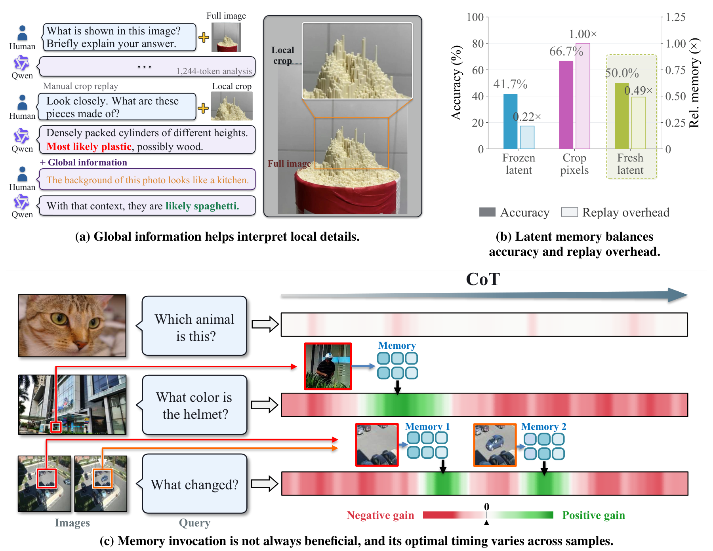
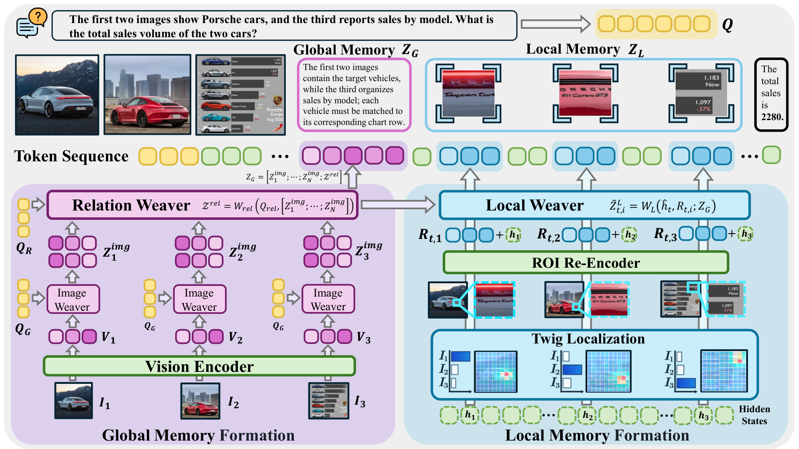
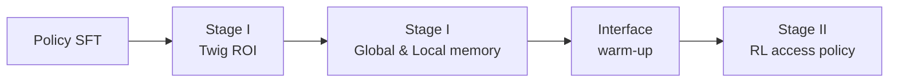

<div align="center">

# 🧠 ReMAP

### Restoring the Perceptual Cycle with Reasoning-Time Latent Visual Memory

[](https://arxiv.org/abs/2610.05097)
[](LICENSE)
[](pyproject.toml)
[](https://pytorch.org)
[](https://huggingface.co/YuhengSSS/Q-Zoom-Qwen2.5VL-7B)

**Hao Jiang**<sup>1\*</sup>, **Zhanyu Guo**<sup>1\*</sup>, **Chenwei Wu**<sup>2†</sup>, **Yichen Guo**<sup>3,4†</sup>, **Qizhe Zhang**<sup>4</sup>,
**Junchi Yao**<sup>5</sup>, **Jixian Wu**<sup>6</sup>, **Jinhao You**<sup>1</sup>, **Kai Tang**<sup>4</sup>, **Jiajun Cao**<sup>4</sup>,
**Tinghao Wang**<sup>1</sup>, **Mengyu Wang**<sup>7</sup>, **Leo Anthony Celi**<sup>8</sup>, **Shanghang Zhang**<sup>4✉</sup>

<sup>1</sup>University of Electronic Science and Technology of China &nbsp;
<sup>2</sup>University of Michigan, Ann Arbor &nbsp;
<sup>3</sup>Nanyang Technological University &nbsp;
<sup>4</sup>Peking University <br>
<sup>5</sup>Mohamed bin Zayed University of Artificial Intelligence &nbsp;
<sup>6</sup>New York University &nbsp;
<sup>7</sup>Harvard University &nbsp;
<sup>8</sup>Massachusetts Institute of Technology

<sub>\* Equal contribution &nbsp;·&nbsp; † Project leader &nbsp;·&nbsp; ✉ Corresponding author</sub>

&nbsp;&nbsp;
&nbsp;&nbsp;
&nbsp;&nbsp;
&nbsp;&nbsp;
&nbsp;&nbsp;
&nbsp;&nbsp;
&nbsp;&nbsp;


</div>

---

## 📰 News

- **2026-10** 📄 Paper released on [arXiv](https://arxiv.org/abs/2610.05097).
- **2026-10** 🚀 Code v1 released: inference, training and evaluation.

## 💡 Why ReMAP?

As multimodal LLMs reason for longer, their attention to the input images fades and
visual grounding weakens. ReMAP lets the model **look again while it reasons**: whenever
the reasoning state calls for it, the model requests visual memory, which returns as a
few compact latent tokens inside the reasoning sequence.

<div align="center">

<p><sub><b>Investigating memory curation, organization and access.</b> (a) Global context
helps interpret local details. (b) Latent memory balances accuracy and replay overhead.
(c) Memory invocation is not always beneficial, and its best timing varies across samples.</sub></p>
</div>

## ✨ Method at a Glance

<div align="center">

</div>

| | |
|---|---|
| 🌍 **Global memory** `<mem_g>` | A static, question-conditioned summary of every image and of their relations, built by Image and Relation Weavers: 16 latent tokens for 1–3 images, 4N + 4 for N images. |
| 🔍 **Local memory** `<mem_l>` | Region-level evidence for the *current* reasoning state: up to three images are selected, Twig locates a region in each, and the re-encoded regions are compressed into 32 latent tokens, anchored on the global context. |
| 🎯 **Learned access** | A reinforcement-learning policy, trained with branched rollouts, decides when to keep reasoning and when to read Global or Local memory. |
| ⚡ **Compact by design** | Memory returns as latent tokens in the reasoning sequence instead of re-feeding images at full resolution. |

## 🛠️ Installation

```bash
git clone https://github.com/Haohaha-11/ReMAP.git
cd ReMAP
pip install -e .                                   # PyTorch 2.4 · Transformers 4.51.3 · PEFT 0.19.1
pip install flash-attn==2.7.3 --no-build-isolation
pip install -e ".[data,judge]"                     # optional: teacher API client, LLM judge
```

ReMAP builds on the [Q-Zoom Qwen2.5-VL-7B](https://huggingface.co/YuhengSSS/Q-Zoom-Qwen2.5VL-7B)
checkpoint. A ReMAP checkpoint directory holds `remap_config.json`, `memory.safetensors`
(memory modules, Twig, memory-token rows and the policy LoRA), `fact_writer.safetensors`,
`fact_writer_config.json` and `chat_template.json`.

## 🚀 Quick Start

```python
from remap.modeling import FactWriter, ReMAP
from remap.inference.session import DecodeConfig, generate, prompt_content
from remap.scoring.benchmarks import project_question

base = "YuhengSSS/Q-Zoom-Qwen2.5VL-7B"
model = ReMAP.from_pretrained("checkpoints/remap", base_model=base)
writer = FactWriter.from_pretrained("checkpoints/remap", base_model=base)   # Global clauses for 1-3 images

question = project_question("Question: <image> <image> Which image shows ...?\nChoices:\n(A) ...")
images = ["a.jpg", "b.jpg"]
result = generate(model, images, prompt_content(question, len(images)), question=question,
                  fact_writer=writer, config=DecodeConfig(max_new_tokens=768, max_calls=4))

print(result.text)                               # reasoning, ending with "Answer: ..."
print([event.kind for event in result.events])   # memory reads, e.g. ['local', 'global']
```

> 💡 Decoding is greedy by default. `DecodeConfig(allow_memory=False)` turns memory off.

## 📊 Evaluation

```bash
torchrun --nproc_per_node 8 -m remap.evaluation.generate \
    --checkpoint checkpoints/remap --base-model YuhengSSS/Q-Zoom-Qwen2.5VL-7B \
    --data benchmarks/muirbench.jsonl --output predictions/muirbench

python -m remap.evaluation.score --data benchmarks/muirbench.jsonl --predictions predictions/muirbench
```

- Supported benchmarks: V\*Bench, CV-Bench (2D/3D), BLINK, MuirBench, MMSI-Bench, RealWorldQA,
  HR-Bench (4K/8K), MIMIC (common / counting / odd-one-out / listing), MathVista and MM-Vet.
- Multiple-choice benchmarks use their official answer parsers, and MIMIC tasks use the released MIMIC metrics.
- MM-Vet and free-form MathVista answers need an LLM judge (`--judge`; set `OPENAI_API_KEY`,
  `OPENAI_API_URL`, `JUDGE_MODEL`).
- Input format: [docs/data.md](docs/data.md).

## 🏋️ Training



Every stage runs with `torchrun` (one process per GPU) and a YAML file in [configs/](configs).

| Step | Entry point | Trains |
|---|---|---|
| 🧩 Policy SFT | `remap.training.policy_sft` | policy LoRA and memory-token rows on teacher trajectories |
| ✍️ Fact writer | `remap.training.pretrain.fact_writer` | decoder and vision LoRA of the writer that provides Global clauses |
| 📥 Stage I data | `remap.training.stage1.collect` | records the student's state at every memory request |
| 🧑‍🏫 | `remap.training.stage1.annotate` | teacher continuations after each read, independently reviewed |
| 📍 | `remap.training.stage1.review_roi` | teacher-reviewed regions for the student's Local reads |
| 🧠 Stage I | `remap.training.stage1.train` | Global memory, Local weaver or Twig (`configs/stage1_{global,local,twig}.yaml`) |
| 🔌 Interface warm-up | `remap.training.interface_warmup` | memory-token rows on successful complete trajectories |
| 🎯 Stage II | `remap.training.rl.train` | when to read which memory: policy LoRA and request-token rows |

<details>
<summary><b>Example commands</b></summary>

```bash
# 1. collect student states and annotate them with a teacher model
torchrun --nproc_per_node 8 -m remap.training.stage1.collect --checkpoint ckpt --base-model <base> \
    --questions train.jsonl --output states/
cat states/states.rank*.jsonl > states/states.jsonl
python -m remap.training.stage1.annotate --states states/states.jsonl --questions train.jsonl \
    --output annotations/                          # needs TEACHER_API_URL and TEACHER_API_KEY

# 2. Stage I memory training
torchrun --nproc_per_node 8 -m remap.training.stage1.train --config configs/stage1_local.yaml

# 3. Stage II reinforcement learning
torchrun --nproc_per_node 8 -m remap.training.rl.train --config configs/stage2_rl.yaml
```

</details>

- The teacher is any OpenAI-compatible multimodal chat endpoint; we used Qwen3.5-397B-A17B.
- Stage II rewards combine the task score with a bounded, decaying bonus for memory reads
  ([`rewards.py`](remap/training/rl/rewards.py)).

> 📝 The relation producer, the Local image selector, set-context fusion and answer reader,
> and the Global-to-Local conditioner were trained in earlier experiments with model variants
> that this release does not contain. They stay frozen in all stages above, and their training
> code is not included.

## 🗂️ Repository Structure

```
remap/
├── modeling/      # ReMAP model: memory tokens, Global/Local memory, relation memory, Twig, fact writer
├── inference/     # decoding with memory requests (evaluation and RL rollouts)
├── scoring/       # typed answer verification, benchmark parsers and metrics, LLM judge
├── evaluation/    # batch generation and scoring
├── data/          # teacher API client
└── training/      # stage1/, rl/, interface warm-up, policy SFT, fact writer
configs/           # one YAML file per training stage
docs/data.md       # data formats
tests/             # CPU unit tests
```

## 📌 Roadmap

- [x] Paper on arXiv
- [x] Code v1: inference, training and evaluation
- [ ] Model weights
- [ ] Training data

> The code is a cleaned-up version of our research code and was checked to produce the same
> outputs as the original implementation on test cases.

## 📖 Citation

If you find ReMAP useful, please cite:

```bibtex
@article{jiang2026remap,
  title   = {ReMAP: Restoring the Perceptual Cycle with Reasoning-Time Latent Visual Memory},
  author  = {Jiang, Hao and Guo, Zhanyu and Wu, Chenwei and Guo, Yichen and Zhang, Qizhe and
             Yao, Junchi and Wu, Jixian and You, Jinhao and Tang, Kai and Cao, Jiajun and
             Wang, Tinghao and Wang, Mengyu and Celi, Leo Anthony and Zhang, Shanghang},
  journal = {arXiv preprint arXiv:2610.05097},
  year    = {2026}
}
```

## 🙏 Acknowledgements

ReMAP builds on [Qwen2.5-VL](https://github.com/QwenLM/Qwen2.5-VL) and
[Q-Zoom](https://github.com/YuHengsss/Q-Zoom), and its access-policy optimisation follows the
partial-rollout idea of [ARPO](https://github.com/RUC-NLPIR/ARPO). See [NOTICE](NOTICE).

## 📄 License

Released under the [Apache License 2.0](LICENSE).
